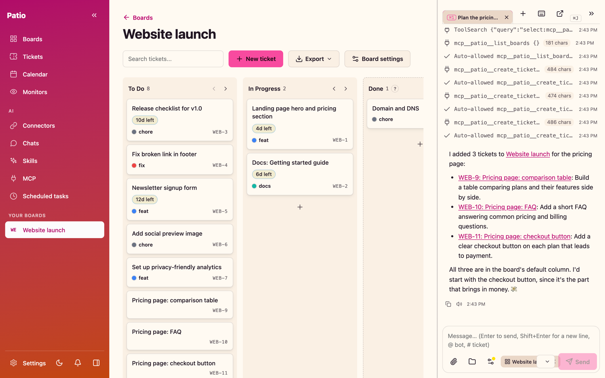
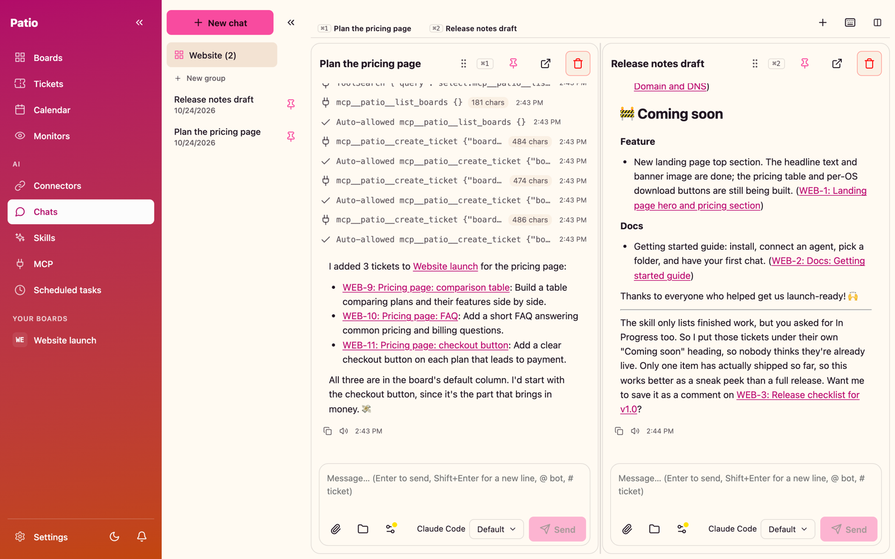
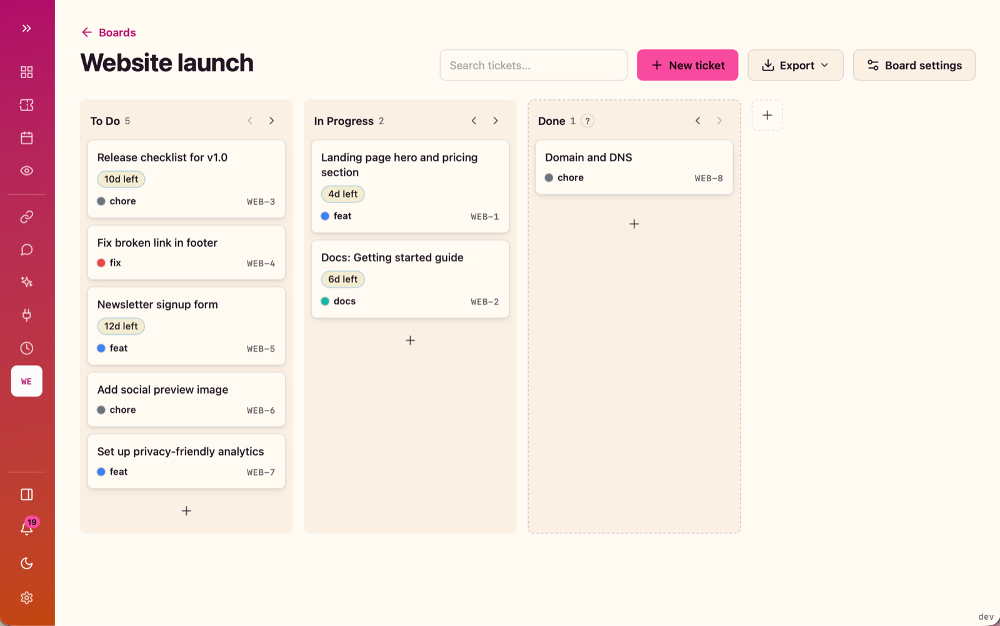
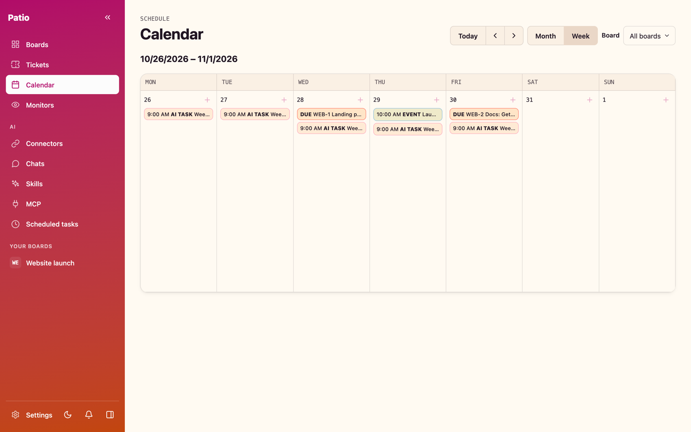
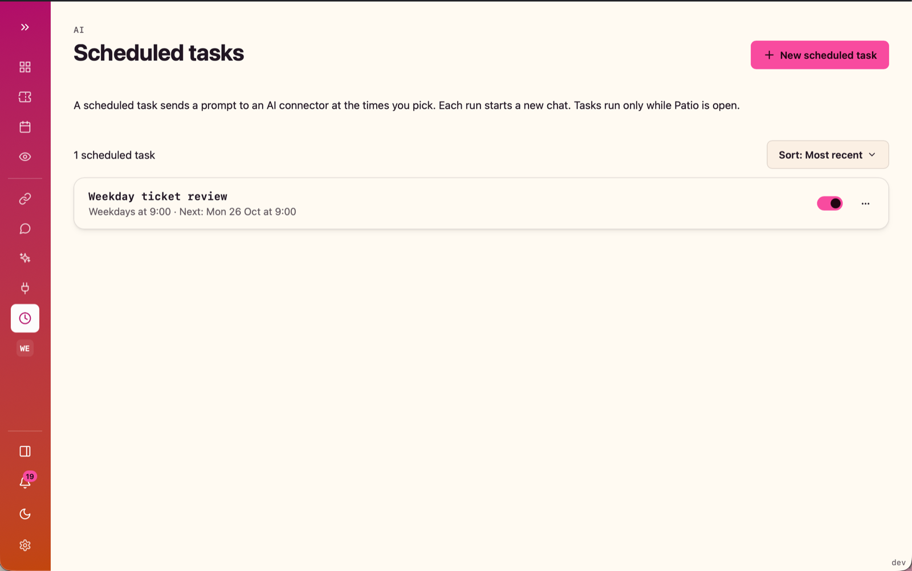

<p align="center">
  
</p>

<h1 align="center">Patio</h1>

<p align="center">
  <b>Your agents. Your work. One place.</b><br>
  An open-source desktop workspace for <b>AI chats</b>, <b>kanban boards</b>, and <b>automation</b>.<br>
  <a href="https://github.com/epulla/patio/actions/workflows/release.yml"></a>
</p>

<p align="center">
  <a href="https://github.com/epulla/patio/releases/latest"></a><br>
  <sub>macOS (Apple Silicon and Intel) · Windows x64 · Linux x64 · <a href="#1-install-patio">install steps</a> · <a href="https://github.com/epulla/patio/releases">all releases</a></sub>
</p>

Bring Claude Code, Codex, GitHub Copilot, opencode, or local AI into your workflow. Keep conversations alongside kanban boards, work with files, and delegate focused tasks between supported agents. Built with **Go, Wails, React, and SQLite**, with application data stored on your computer.

[Get started](#get-started) · [Connectors](#connectors) · [Automation](#automate-routine-work) · [MCP](#connect-through-mcp) · [Build from source](#build-from-source)



## What you can do

| Bring the pieces together | Put them to work |
| --- | --- |
| **Your AI tools** | Connect the coding CLIs and accounts you already use, or choose a local AI endpoint. |
| **Coordinated conversations** | Pin chats, arrange them in grids or split views, and let supported agents hand work to another chat and receive the result. |
| **Organized projects** | Track work with kanban boards, Markdown tickets, comments, due dates, and status history. |
| **Repeatable routines** | Schedule a prompt and give each run its own chat and recorded outcome. |
| **Changes that lead to action** | Monitor an MCP tool, then notify, create a ticket, or start a chat when a configured condition matches. |
| **Reusable instructions** | Save skills and preferences so new conversations can pick up the way you work. |

## Get started

### 1. Install Patio

Download the build for your computer from [Releases](https://github.com/epulla/patio/releases/latest).

| Platform | Download |
| --- | --- |
| macOS — Apple Silicon | [patio-darwin-arm64.zip](https://github.com/epulla/patio/releases/latest/download/patio-darwin-arm64.zip) |
| macOS — Intel | [patio-darwin-amd64.zip](https://github.com/epulla/patio/releases/latest/download/patio-darwin-amd64.zip) |
| Windows — x64 | [patio-windows-amd64.exe](https://github.com/epulla/patio/releases/latest/download/patio-windows-amd64.exe) |
| Linux — x64 | [patio-linux-amd64](https://github.com/epulla/patio/releases/latest/download/patio-linux-amd64) |

<details>
<summary>macOS installation</summary>

Extract the archive and move `patio.app` to `/Applications`.

The macOS build is unsigned. On first launch, right-click the app and choose **Open**. If macOS still blocks it, you can remove quarantine from this app:

```sh
xattr -dr com.apple.quarantine /Applications/patio.app
```

</details>

<details>
<summary>Linux installation</summary>

Patio requires GTK 3 and WebKit2GTK runtime libraries. On Ubuntu 22.04:

```sh
sudo apt install libgtk-3-0 libwebkit2gtk-4.0-37
chmod +x patio-linux-amd64
./patio-linux-amd64
```

Package names can differ on other distributions.

</details>

On Windows, open the downloaded executable.

### 2. Connect an agent

Open **Connectors**, choose **Add connector**, and select an installed CLI or **Local AI**.

Reuse the CLI's existing login or configure a separate account where supported. Connector cards show installation and sign-in status, with plan and usage information when the provider exposes it.

### 3. Choose a workspace

In **Settings → Allowed folders**, add a folder you want to work in. Start a chat with that folder, or use a scratch folder for a separate workspace.

Choose your connector and model. In **Settings → Defaults**, set your preferred connector, folder, thinking options, and approval mode. **Auto-allow is enabled by default**; turn it off to review approval requests supported by your connector.

### 4. Put it to work

Open a chat and try:

> Create a board called Website launch. Add tickets for the landing page, documentation, and release checklist. Give each ticket a short description.

Then pin the chat alongside your work, add a skill for a repeatable task, or schedule a daily review.

## Connectors

| Connector | What Patio connects to |
| --- | --- |
| **Claude Code** | The installed `claude` CLI and its signed-in account. |
| **Codex** | The installed `codex` CLI and its signed-in account. |
| **GitHub Copilot** | The installed `copilot` CLI and its signed-in account. |
| **opencode** | The installed `opencode` CLI, with support for v1 and v2. |
| **Local AI** | Ollama, LM Studio, llama.cpp, or another compatible endpoint. |

Patio uses your existing provider access. Available models, subscription requirements, and usage limits depend on the connected tool and account.

Additional CLI accounts use separate configuration directories. Separate opencode accounts are not supported on Windows. An additional Copilot account uses a fine-grained GitHub token with the **Copilot Requests** permission.

### Local AI

Local AI provides file tools inside the selected chat folder and a focused set of Patio tools for boards, tickets, calendar items, and skills. Tool calling and image support depend on the selected model and server.

Its tool set is intentionally smaller than the CLI integrations: external MCP servers, chat delegation, and schedule or monitor administration are not exposed to Local AI chats.

## Work in Patio

### Keep conversations in view

- Stream replies with saved history and a model picker.
- Pin chats, organize them into groups, reorder tabs, and arrange conversations in a grid or custom split.
- Keep a chat dock beside a board or ticket, and share that item's context with the agent.
- Open a chat in its own window when you want more space.
- Queue messages while a reply is running.
- Attach text files and images through the paperclip, drag and drop, or paste.
- Follow links from replies to tickets, boards, chats, and local files.



Attachments support up to 10 files per message: text, CSV, PDF, Office (Word, Excel, PowerPoint) and zip files up to 1 GB each, and PNG, JPEG, GIF, or WebP images. PNG, JPEG, and WebP images larger than 2000 px or 5 MB are shrunk before upload; GIFs can be up to 10 MB. Images are sent to models that support them; other connectors receive the file path.

### Delegate focused work

Supported CLI agents can use `create_chat` to delegate to a new child chat or `send_to_chat` to message an existing chat. A child can use another connector or model, and `report_back` can return its final result automatically.

A handoff carries an explicit task prompt. It inherits the selected work folder and relevant chat settings, rather than copying the full conversation transcript. A child of a scratch-folder chat receives its own scratch folder.

### Turn conversations into organized work

- **Boards:** create and reorder boards, customize columns, and move tickets by dragging.
- **Tickets:** write Markdown descriptions, add comments and ticket links, set types and due dates, and inspect status history.
- **Search:** find tickets across boards by title or code, with board and date filters.
- **Calendar:** see calendar items, due tickets, and past or upcoming scheduled runs.
- **Export:** save boards as Excel, CSV, or JSON; export individual tickets as JSON or Markdown.
- **Import:** restore a board JSON export as a new board, including on another computer.
- **Print:** produce a clean ticket view with history and transitions.

Temporary columns can hide older tickets. New boards use To Do, In Progress, and a temporary Done column that hides tickets after one day.

|  |  |
| --- | --- |

### Reuse skills and preferences

Write a skill in Markdown or import a `SKILL.md` file. Use the **Memory** tab in Skills to keep preferences and facts you want to reuse.

Enabled skills and memory summaries are made available to new CLI chats. Local AI can discover and load skills through its supported tools. Changes apply to new chats.

### Make the workspace yours

Choose English or Spanish, system/light/dark appearance, one of five color palettes, and a flat or gradient sidebar. Keyboard shortcuts and chat defaults are available in Settings.

## Automate routine work

### Scheduled tasks: start with a time

Give Patio a prompt, connector, model, and schedule. Choose a one-time run, a recurring preset, or an advanced cron expression.

Each run starts a new chat with the task's folder, thinking settings, and approval mode. Patio records the outcome and notifies you when a run finishes, fails, or needs attention.

Example prompt for a weekday review:

> Review tickets due this week. Summarize what is overdue and suggest the next three priorities.



### Monitors: start with a condition

A monitor calls a selected MCP tool on a schedule and checks whether:

- The result changed.
- The result is not empty.
- New items appeared in a list.

When the condition matches, it can send a notification, create a ticket, start a chat, or combine those actions. A chat started by a monitor uses your current chat defaults.

For example, with a suitable MCP server configured, watch for newly reported issues and create a ticket when a new item appears. The check itself does not start an AI chat; the chat action does.

**Scheduled tasks and monitors run while Patio's main application window is open.** A detached chat window does not keep them running. After reopening Patio, an overdue scheduled task runs once; missed intervals are not all replayed. An occurrence is skipped if the previous run is still working.

## Connect through MCP

Patio supports MCP in two directions.

### Bring external tools into Patio

Add a local command-based server over stdio or a remote HTTP server. Configure authentication where needed, inspect the tools and health status, and enable the server for supported CLI chats.

Local AI uses its smaller built-in tool set.

### Bring Patio into another AI client

Run Patio as a stdio MCP server using the installed executable with the `mcp` argument. It accesses the same database as the desktop app.

Open **Settings → MCP status** to copy a configuration with your actual executable path and inspect the available tools.

Example configuration for macOS:

```json
{
  "mcpServers": {
    "patio": {
      "command": "/Applications/patio.app/Contents/MacOS/patio",
      "args": ["mcp"]
    }
  }
}
```

On Windows, use the full path to `patio-windows-amd64.exe`. On Linux, use the full path to `patio-linux-amd64`. Configuration formats can vary between clients.

To select a different database, put the flag after `mcp`:

```json
{
  "args": ["mcp", "-d", "/absolute/path/to/patio.db"]
}
```

Patio's MCP tools cover work management, calendar items, scheduled tasks, monitors, skills, connectors, and settings. Read-only SQL reporting is available through `query_db`, with a schema resource at `patio://schema`.

The built-in MCP tool set does not expose deletion of boards, tickets, ticket types, connectors, or MCP servers. It does allow removing empty columns, calendar items, scheduled tasks, monitors, skills, and ticket links. `update_settings_defaults` cannot change Auto-allow. These limits describe Patio's MCP tools; a connected CLI may have additional tools of its own.

## Data and permissions

### Your application data

Patio stores its application data in a local SQLite database.

| Platform | Default database |
| --- | --- |
| macOS | `~/Library/Application Support/patio/patio.db` |
| Windows | `%LOCALAPPDATA%\patio\patio.db` |
| Linux | `$XDG_DATA_HOME/patio/patio.db` when that variable is an absolute path; otherwise `~/.local/share/patio/patio.db` |

Chat scratch folders, attachments, and separate CLI account directories live outside the database. **Settings → General** shows the database, data folder, and log locations.

Use `-d /absolute/path/to/patio.db` to choose another database. The optional `-show-hidden` flag reveals the assignee field in the interface.

### Credentials and approvals

Secrets managed by Patio use the operating system credential store: macOS Keychain, Windows Credential Manager, or Linux Secret Service. Connected CLIs manage their own account credentials and may keep them in their configuration directories.

Patio displays approval requests supported by each connector. Auto-allow runs those actions without prompting and records them in the conversation. Approval behavior depends on the connector and tool; choose your preferred mode in Settings or per chat.

Local storage describes the workspace data. Hosted connectors and remote MCP servers communicate with their respective services.

### Backups

For a portable board backup, export it as JSON and import it on the destination computer.

For a database backup, stop Patio and any Patio MCP processes before copying `patio.db`. A database-only backup does not include chat files, attachments, separate CLI account folders, or secrets in the OS credential store. Preserve the files you need and reconnect accounts after migration.

## Build from source

The current build uses:

- **Go 1.27**, as declared in [go.mod](go.mod).
- **Node.js 22 (22.12+)** and **pnpm 11**.
- **Wails CLI v2.16.0**, matching the Wails dependency.

On macOS, install the Xcode command-line tools. On Ubuntu 22.04, install the native build dependencies:

```sh
sudo apt update
sudo apt install libgtk-3-dev libwebkit2gtk-4.0-dev build-essential pkg-config
```

Clone and build:

```sh
git clone https://github.com/epulla/patio.git
cd patio
go install github.com/wailsapp/wails/v2/cmd/wails@v2.16.0
wails build
```

Build output is written to `build/bin/`. Wails runs the pnpm frontend install and build commands configured in [wails.json](wails.json).

## Development

Read [AGENTS.md](AGENTS.md) for repository conventions. Use pnpm for frontend work.

Start the development app:

```sh
wails dev
```

Useful checks:

```sh
go vet ./...
go test ./... -count=1
pnpm --dir web install --frozen-lockfile
pnpm --dir web build
wails build
```

`make test` runs the Go tests. `make release` performs a CGO-free Windows compilation check. Tagged releases are built and published by [GitHub Actions](.github/workflows/release.yml).

Logos, README artwork, and native application icons are documented in [Brand assets and Wails icons](docs/branding/README.md).

For bug reports, include the Patio version, operating system, connector, and steps to reproduce. You can find version and log information in **Settings → General**.

## License

Patio is available under the [MIT License](LICENSE).

For Dolores, Domenica, Gary and José Martín.
